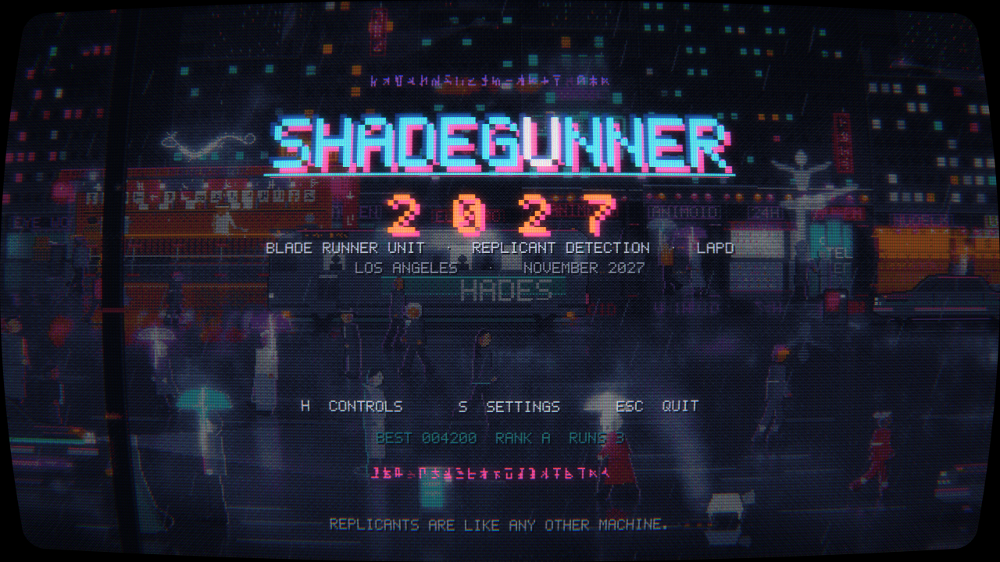
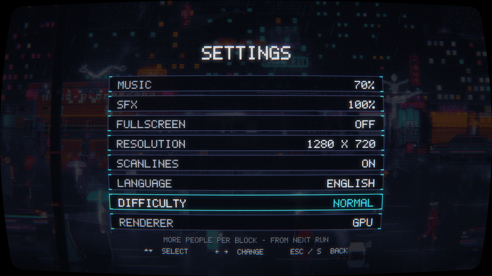
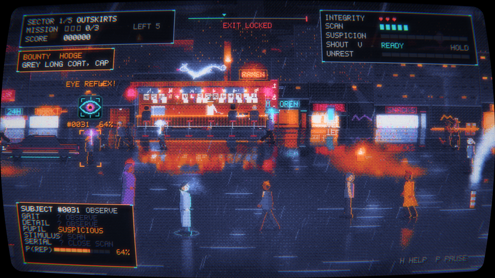
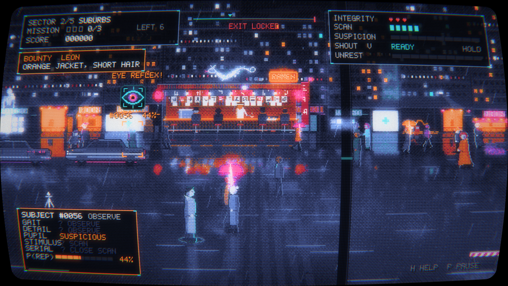
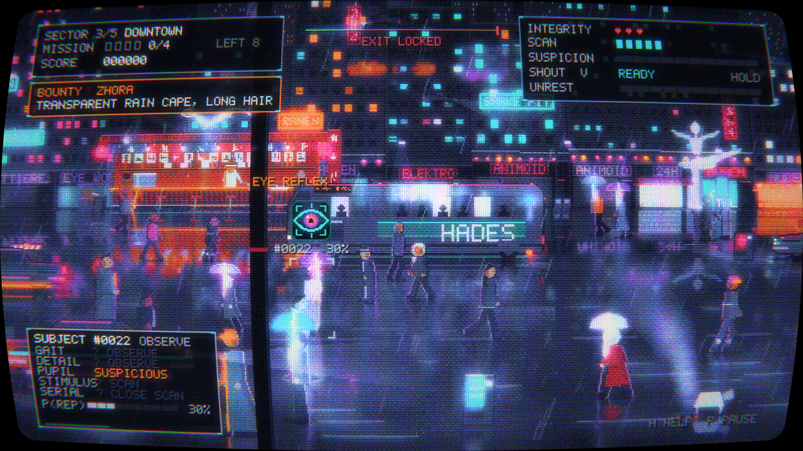
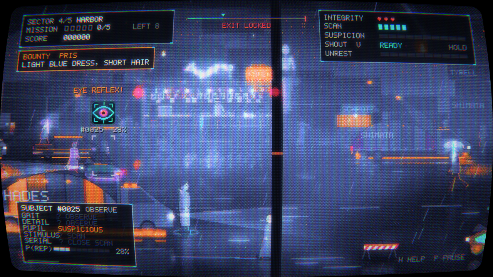
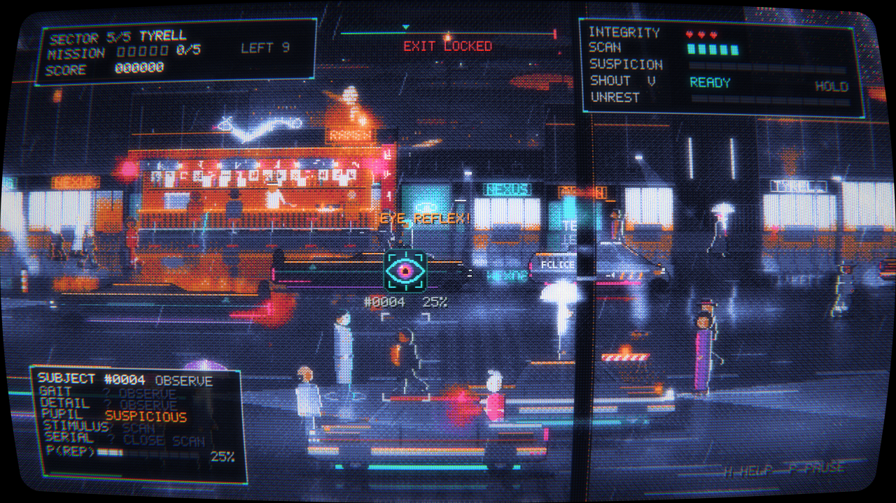

<p align="center"></p>

# ShadeGunner

[English](README.md) · **Deutsch**

16-Farben-Cyberpunk-Sidescroller im Blade-Runner-Universum. Als Blade Runner
arbeitest du dich von den Außenbezirken bis ins Tyrell-HQ und musst
**Replikanten unter Passanten erkennen, scannen und deaktivieren** – und mit den
Folgen deiner Entscheidungen leben.

Gebaut auf dem `asciiplay`-Renderpfad: Bayer-Dither gegen eine feste 16-Farben-
Palette plus CRT-Kette (Wölbung, Scanlines, Schattenmaske, Bloom, Nachleuchten).
Die Szene wird auf der CPU komponiert, Figuren und Sound sind prozedural, die
Post-Verarbeitung läuft auf der GPU. Python 3 + PyQt6. Oberfläche und Texte gibt
es auf **Deutsch und Englisch** (in den Einstellungen umschaltbar).

## Screenshots

| | |
|---|---|
|  |  |
|  |  |
|  |  |



## Kern-Loop

Beobachten → Ziel wählen → **scannen** (begrenzte Ladungen) → **Tell-Konfidenz**
(Naive Bayes, über den echten Replikantenanteil der Zone kalibriert) →
zielen/schießen (Passanten in der Schusslinie fangen die Kugel) → Quote erfüllen,
Ausgang öffnet sich → 1 aus 3 Upgrades. **Zivilisten töten ⇒ Verdacht** (ab 100 %
ist der Einsatz verloren).

Wer einen **Augenreflex** erwischt – beim Beobachten, per Scan, im Polizei-
Suchlicht oder beim Stromausfall –, sieht über der Person kurz das Emblem des
Spiels aufblitzen (Auge im Scanner-Fadenkreuz). Es markiert den Tell, nicht die
Wahrheit: Auch Menschen zeigen gelegentlich einen falschen Reflex.

- **Zonen:** Außenbezirk → Vorstadt → Innenstadt → Hafen → Tyrell.
- **Abwechslung:** Springen (über Hindernisse, Schlägen ausweichen), Verkehr auf zwei
  Fahrspuren, Polizei-Suchlicht (macht Augenreflexe sichtbar), Stromausfall,
  Kopfgeld-Replikanten, **landende Polizei-Spinner** (Abwind schiebt alle weg, danach
  Kontrolle mit Suchlicht vom Boden aus; der Spinner sperrt den Mittelstreifen),
  **Gaffs Origami** (eine Figur pro Zone: Huhn, Streichholzmann, Schaf, Kranich, Einhorn;
  Fund = Punkte + Scanner voll) und **Nudelbars** im Stil des White Dragon (Theke,
  Gäste, Koch, Neon-Drache; kurz an der Theke stehen füllt ein Herz auf).
- **Volle Straßen – und jeder ist Teil der Simulation:** Passanten auf der Fahrbahn,
  Flaneure auf dem hinteren Gehweg vor den Läden und **Gruppen, die herumstehen und
  reden**. Alle sind beobachtbar und scanbar, Replikanten verstecken sich in jeder Sorte.
  Schwierigkeit LEICHT/NORMAL/SCHWER skaliert die Menge.
- **Ansprechen und Rufen (`V`):** Kurz tippen spricht das Ziel an („Sie da! Stehen
  bleiben!“): Menschen heben die Hände und antworten, wer den REIZ-Tell hat, starrt nur.
  Halten lädt einen Ruf an die Menge, beim Loslassen läuft „LAPD! Alle runter!“ als
  sichtbare Welle über die Straße; jeder reagiert, wenn sie ihn erreicht, mit eigener
  Schrecksekunde. Wer den REIZ-Tell hat, bleibt **reglos stehen**, die anderen gehen **in
  Deckung** (die Kugel geht über Geduckte hinweg) oder rennen. Jeder Ruf erhöht die
  **Unruhe** der Straße: mehr Leute rennen, Replikanten werden nervös und hauen ab.
- **Kein Fahrzeug gleicht dem anderen:** Korosseriefarben, Akzentfarben (Zierlinien,
  Zweifarbdach, Schweller, Rallyestreifen), Unterboden-Neon, Helligkeit und Schriftzüge
  (Tyrell, Shimata, Pan Am, Off-World, Nexus 6, Eye Works …) werden je Fahrzeug
  kombiniert – auch Taxi-Dachschilder, Bus-Werbeband, Buslinie (z. B. „12 HADES“) und
  Laster-Aufschrift sind zufällig. 16 Varianten je Art.
- **Verkehr wird zur Kolonne:** Mit jedem Viertel fahren mehr Fahrzeuge – und je dichter
  der Verkehr, desto langsamer fließt er: Stop-and-go, haltende Taxis, Stau-Hupen, in der
  Innenstadt meist 5–7 Fahrzeuge im Bild. Und je langsamer und voller, desto **leiser**
  die Motoren. Stehst du in der Spur, hupt der Fahrer und **bremst** ab – angefahren wirst
  du nur noch, wenn du in letzter Sekunde vors Auto läufst (ganz vorn ist es wirklich
  gefährlich, im dichten Innenstadtverkehr kaum noch). Läufst du seitlich gegen ein Auto,
  gibt es nur einen kurzen **Rempler** (Stun), kein Herz. Am Fahrbahnrand **parken** Autos, Taxis, Laster
  (manche mit Warnblinker); sie sind zu hoch zum Drüberspringen und verdecken, wer
  dahinter steht.
- **Dampfende Gullis:** wie in New York – Gullideckel mit Glut im Spalt und gestreifte
  Dampfschlote, die in Schüben qualmen. Im Dampf sieht man fast nichts: Wer dort steht,
  lässt sich kaum beobachten.
- **Eigene Musik je Viertel:** Außenbezirk mit dem Titelthema, danach mit jeder Zone
  dichter (Arpeggien, Chor, Nebelhorn und Hafenmetall, Tyrell groß und hell). Dazu eine
  taktgleiche **Rhythmus-Spur** – vom Herzschlag in der Vorstadt bis zum treibenden
  Sequenzer in Tyrell –, die mit der Spannung lauter wird (Zielen, Unruhe, Flucht,
  Verdacht, ROY) und langsam wieder abklingt.
- **Holografische Ballerinas** (Blade Runner 2049): riesige Tänzerinnen über den Dächern
  und kleine auf Projektorsockeln am Gehweg – Pirouette, Seconde, Arabeske mit Promenade,
  Scanlines, Aussetzer, Glitches; im Stromausfall gehen sie aus.
- **Verkehr nach Syd Mead:** Polizei-Spinner mit Kapsel-Kanzel und Radgondeln,
  Deckard-Sedan, Metrokab mit Glas-Dom, Sebastians Armadillo-Laster, Aerial-Limousine,
  Stadtbus voller Fahrgäste, Motorrad mit Radscheiben.
- **Endboss:** In Tyrell tritt **ROY** auf. Er redet seine Sprüche (dabei
  unverwundbar) und verträgt zwischen den Sätzen Treffer. Das Tor öffnet erst,
  wenn er liegt.

## Steuerung

| Taste | Aktion |
|---|---|
| `A/D`, `W/S` (Pfeile) | gehen, Tiefe (nah/fern) |
| `Shift` | sprinten |
| `Space` | springen |
| Maus zeigen / klicken | Ziel wählen |
| `Q` / `Tab` / Mausrad | Ziel wechseln |
| `R` / rechte Maustaste | gewähltes Ziel scannen |
| `E` / linke Maustaste | halten = zielen, loslassen = schießen |
| `C` / rechte Maustaste | Schuss abbrechen (Waffe senken) |
| `V` / mittlere Maustaste | tippen = Ziel ansprechen, halten + loslassen = Ruf „LAPD! Alle runter!“ |
| `P` Pause · `H` Hilfe · `F` Vollbild · `M` Ton · `S` Einstellungen (Titel/Pause) | |

## Start

```bash
pip install -r requirements.txt
python3 -m shadegunner            # oder: tools/run.sh
```

Menü-Eintrag mit Icon (Linux, pro Benutzer, ohne root): `tools/install_desktop.sh`
(entfernen mit `--uninstall`).

Beim ersten Start wird der Soundtrack einmalig (~11 s) nach
`~/.cache/shadegunner/audio-v2/` erzeugt; danach startet es sofort.
Abschalten: `SHADEGUNNER_NOSOUND=1`.

## Windows

**Download:** eine fertige Version liegt unter [Releases](https://github.com/3p1cball-code/ShadeGunner/releases/latest) –
`ShadeGunner-win.zip` entpacken und `ShadeGunner\ShadeGunner.exe` starten (kein Python nötig).

Oder selbst bauen, zwei Wege:

1. **Aus dem Quelltext** – einmalig `install.bat` (installiert PyQt6 und numpy),
   danach starten mit `tools\run.bat`.
2. **Eigenständige `.exe`** (kein Python nötig, der Weg für Steam):
   `tools\build_windows.bat` baut mit PyInstaller `dist\ShadeGunner\ShadeGunner.exe`.
   Diesen kompletten Ordner an Steam ausliefern.
   Wichtig: PyInstaller kann eine Windows-`.exe` **nur auf Windows** erzeugen –
   der Build muss also auf einem Windows-Rechner laufen (die Spec `shadegunner.spec`
   liegt bei).

Auf Windows liegen Speicherstand unter `%APPDATA%\shadegunner\` und der
Klang-Cache unter `%LOCALAPPDATA%\shadegunner\`.

## Technik

- **Renderpfade:** Standard ist OpenGL 3.3 (GPU: Bayer-Dither + CRT-Kette). Fehlt
  OpenGL 3.3 (VM, Server, alte/keine GPU), schaltet das Spiel automatisch auf einen
  **CPU-Fallback** um (Dither + Scanlines + Vignette, ~25–30 fps). Erzwingbar mit
  `--software` oder `SHADEGUNNER_SOFTWARE=1` (braucht numpy).
- Interne (Dither-)Auflösung 640×360, wird per CRT/Anzeige hochskaliert.
- Palette `noir16` (eigene Noir-Palette) als Standard.
- Das Spiel selbst ist **numpy-frei**; numpy wird nur zur Klang-Erzeugung genutzt
  (mit Fallback ohne numpy).
- **Einstellungen** (Musik, Effekte, Vollbild, **Auflösung**, Scanlines, **Sprache**
  Deutsch/Englisch, Schwierigkeit, Renderer) liegen
  neben dem Spielstand (`%APPDATA%\shadegunner\settings.json` bzw. XDG-Pfad). Im Fenster
  bekommt das Spiel exakt die gewählte Auflösung (zentriert); im Vollbild gilt die
  Bildschirmauflösung.
- Tests: `python3 tests/test_sim.py` (Simulation, ohne GL).

## Werkzeuge

- `tools/glshot.py` – Offscreen-GPU-Render nach PNG (`--hud`, `--size=1920x1080`, `--lang=en`, …)
- `tools/playtest.py` – End-to-End mit echtem `GameWidget`
- `tools/autoplay.py` – Balancing-Bot
- `tools/spritesheet.py` – Sprite-Übersicht
- `tools/make_brand.py` – Icon (`assets/icons/`, PNG 16–512 + `.ico`), Logo und
  GitHub-Social-Preview, aus dem Code erzeugt durch die eigene Dither-/CRT-Kette
  des Spiels (der Logo-Hintergrund ist eine echte Spielszene)
