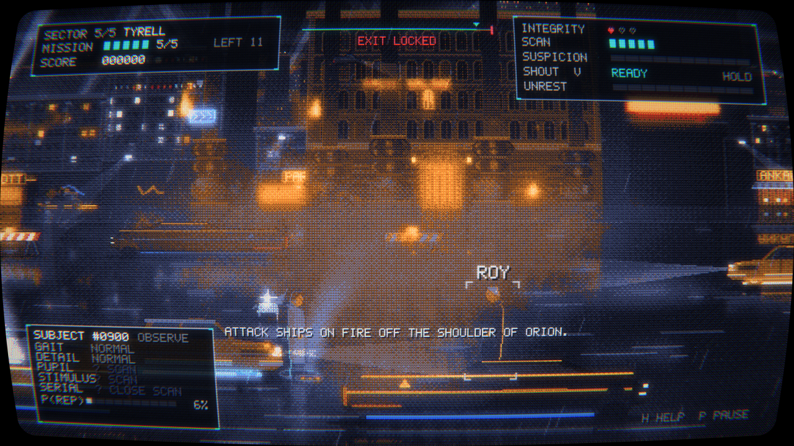

<p align="center"></p>

# ShadeGunner

**English** · [Deutsch](README.de.md)

A 16-color cyberpunk side-scroller set in the Blade Runner universe. As a Blade
Runner you work your way from the outskirts to the Tyrell HQ, and you have to
**spot, scan and deactivate replicants among the passers-by** – and live with the
consequences of your decisions.

**Also available for Android and handhelds:** a native
[Godot 4 port](https://github.com/3p1cball-code/ShadeGunner-Android) with touch,
gamepad and keyboard controls.

Built on the `asciiplay` render path: Bayer dithering against a fixed 16-color
palette plus a CRT chain (curvature, scanlines, shadow mask, bloom, phosphor
persistence). The scene is composed on the CPU, figures and sound are procedural,
post-processing runs on the GPU. Python 3 + PyQt6. UI and in-game text are
available in **German and English** (switchable in the settings).

## Screenshots

| | |
|---|---|
|  |  |
|  |  |
|  |  |
|  |  |

## Atmosphere first

The game is meant to be played calmly: walk through the city, take it in, have a
few moments that feel like the film. The mechanics serve the mood – and the
further you get, the denser and less readable the streets become, until the
question is no longer *who* is a replicant but whether it matters.

- **Own palette per quarter:** every zone has its own 16 colors built around one
  complementary pair plus a few close shades for highlights on the figures
  (outskirts amber ↔ blue/violet, suburbs green/cyan ↔ pink, downtown teal ↔
  signal red, harbor ash blue ↔ sodium, Tyrell gold ↔ deep blue).
- **Dense streets:** old ornate facades with retrofitted cables next to
  hyper-modern blocks, chalk-graffiti monoliths and ornamented columns, wrecks
  and trash in the outskirts (cleaner further in), **bridges and overhanging
  buildings** you walk underneath, pedestrian **signal towers** as free-standing
  objects (some right in front of the camera, slightly out of focus),
  **cables strung across the street** (single or in bundles), thin out-of-focus
  cables and lamps in the foreground, paper litter swirling in gusts, cyclists
  in small groups as pure scenery, a 60s sedan among the modern traffic, paper
  umbrellas with glowing shafts.
- **CRT phosphor:** near-white highlights smear a little longer, and fading
  trails get softer as they decay.

## Core loop

Observe → pick a target → **scan** (limited charges) → **tell confidence**
(Naive Bayes, calibrated against the zone's real replicant ratio) → aim/shoot
(passers-by in the line of fire catch the bullet) → meet the quota, the exit
opens → 1 of 3 upgrades. **Killing civilians ⇒ suspicion** (at 100 % the run is
lost).

When you catch an **eye reflex** – by watching, scanning, under a police
searchlight or in a blackout – the game's emblem (an eye in the scanner
reticle) flashes up above that person. It marks the tell, not the truth:
humans occasionally show a false reflex too.

- **Zones:** Outskirts → Suburbs → Downtown → Harbor → Tyrell.
- **Variety:** jumping (over barriers, barrels and bins – not over wrecks or
  parked cars – and dodging blows), traffic on two lanes,
  police searchlight (reveals eye reflexes), blackouts, bounty replicants,
  **landing police spinners** (the downdraft pushes everyone aside, then a
  ground check with a searchlight; the spinner blocks the median),
  **Gaff's origami** (one figure per zone: chicken, matchstick man, sheep,
  crane, unicorn; finding one = points + scanner refilled) and **noodle bars**
  in the White Dragon style (counter, patrons, cook, neon dragon; standing at
  the counter briefly refills one heart).
- **Full streets – and everyone is part of the simulation:** passers-by on the
  road, strollers on the rear sidewalk in front of the shops, and **groups
  standing around talking**. All of them can be observed and scanned; replicants
  hide in every kind. Difficulty EASY/NORMAL/HARD scales the crowd.
- **Addressing and shouting (`V`):** a short tap addresses the target ("You
  there! Stand still!"): humans raise their hands and answer, whoever has the
  STIMULUS tell just stares. Holding charges a shout to the crowd; on release,
  "LAPD! Everyone down!" rolls across the street as a visible wave, and each
  person reacts with their own moment of shock as it reaches them. Whoever has
  the STIMULUS tell stays **motionless**; the others **take cover** (the bullet
  passes over anyone crouching) or run. Every shout raises the street's
  **unrest**: more people run, replicants get nervous and bolt.
- **No two vehicles look alike:** body colors, accent colors (trim lines,
  two-tone roofs, skirts, racing stripes), underglow, brightness and lettering
  (Tyrell, Shimata, Pan Am, Off-World, Nexus 6, Eye Works …) are combined per
  vehicle – taxi roof signs, bus ad banners, bus route (e.g. "12 HADES") and
  truck lettering are random too. 32 variants per type.
- **Traffic turns into a column:** every quarter has more vehicles – and the
  denser the traffic, the slower it flows: stop-and-go, halted taxis, jam horns,
  usually 5–7 vehicles on screen downtown. And the slower and fuller it is, the
  **quieter** the engines. If you stand in a lane the driver honks and **brakes**
  – you only get run over if you dart in front of a car at the last second
  (truly dangerous up front, barely so in dense downtown traffic). Walk into a
  car from the side and you only get a brief **bump** (stun), no heart lost.
  Along the curb cars, taxis and trucks **park** (some with hazard lights); they
  are too tall to jump over and hide whoever is standing behind them.
- **Steaming manholes:** like in New York – manhole covers glowing in the crack
  and striped steam stacks that puff in bursts. In the steam you can barely see
  anything: whoever stands there is hard to observe.
- **Own music per quarter:** the outskirts with the title theme, then denser
  with each zone (arpeggios, choir, foghorn and harbor metal, Tyrell big and
  bright). Plus a beat-locked **rhythm track** – from a heartbeat in the suburbs
  to a driving sequencer in Tyrell – that grows louder with tension (aiming,
  unrest, flight, suspicion, ROY) and slowly fades again.
- **Holographic ballerinas** (Blade Runner 2049): giant dancers above the roofs
  and small ones on projector pedestals on the sidewalk – pirouette, seconde,
  arabesque with promenade, scanlines, dropouts, glitches; they go dark during a
  blackout.
- **Syd Mead traffic:** police spinner with a capsule cockpit and wheel pods,
  Deckard's sedan, metro-cab with a glass dome, Sebastian's armadillo truck,
  aerial limousine, a city bus full of passengers, a motorcycle with disc wheels.
- **Finale:** Tyrell is a long last sector. Toward the end the city empties –
  derelict blocks, shutters, ornate columns – until **J. F. Sebastian's house**
  (the Bradbury). **ROY** stands in front of it and waits until you come close.
  In the fight he only taunts you with lines from the film. Once he has beaten
  you down to **one heart** he lets go and stands defenseless: one shot is
  enough. If you don't shoot, he speaks – *tears in rain* – dies on his own, and
  a dove rises. The ending reflects which way you chose. The exit only opens once
  the quota is met and ROY is no longer standing.

## Controls

| Key | Action |
|---|---|
| `A/D`, `W/S` (arrows) | walk, depth (near/far) |
| `Shift` | sprint |
| `Space` | jump |
| move / click mouse | pick target |
| `Q` / `Tab` / wheel | cycle target |
| `R` / right mouse button | scan selected target |
| `E` / left mouse button | hold = aim, release = fire |
| `C` / right mouse button | cancel shot (lower weapon) |
| `V` / middle mouse button | tap = address target, hold + release = shout "LAPD! Everyone down!" |
| `P` pause · `H` help · `F` fullscreen · `M` sound · `S` settings (title/pause) | |

## Running

```bash
pip install -r requirements.txt
python3 -m shadegunner            # or: tools/run.sh
```

Menu entry with icon (Linux, per user, no root): `tools/install_desktop.sh`
(remove with `--uninstall`).

On first launch the soundtrack is generated once (~11 s) into
`~/.cache/shadegunner/audio-v2/`; after that it starts immediately.
To disable: `SHADEGUNNER_NOSOUND=1`.

## Windows

**Download:** a ready-to-run build is on the [Releases page](https://github.com/3p1cball-code/ShadeGunner/releases/latest) –
unzip `ShadeGunner-win.zip` and start `ShadeGunner\ShadeGunner.exe` (no Python needed).

Or build it yourself, two ways:

1. **From source** – run `install.bat` once (installs PyQt6 and numpy), then
   start with `tools\run.bat`.
2. **Standalone `.exe`** (no Python needed, the way to go for Steam):
   `tools\build_windows.bat` builds `dist\ShadeGunner\ShadeGunner.exe` with
   PyInstaller. Ship this whole folder to Steam.
   Important: PyInstaller can produce a Windows `.exe` **only on Windows** – the
   build therefore has to run on a Windows machine (the spec `shadegunner.spec`
   is included).

On Windows the save lives under `%APPDATA%\shadegunner\` and the sound cache
under `%LOCALAPPDATA%\shadegunner\`.

## Technical

- **Render paths:** the default is OpenGL 3.3 (GPU: Bayer dither + CRT chain).
  If OpenGL 3.3 is missing (VM, server, old/no GPU), the game switches
  automatically to a **CPU fallback** (dither + scanlines + vignette, ~25–30 fps).
  Can be forced with `--software` or `SHADEGUNNER_SOFTWARE=1` (needs numpy).
- Internal (dither) resolution 640×360, upscaled by the CRT/display chain.
- One 16-color palette per zone (`config.ZONE_LOOK`); the HUD keeps `noir16`.
- The game itself is **numpy-free**; numpy is only used for sound generation
  (with a fallback without numpy).
- **Settings** (music, effects, quality/performance, fullscreen, **resolution**,
  scanlines, **language**, difficulty, renderer) live next to the save
  (`%APPDATA%\shadegunner\settings.json` or the XDG path). In windowed mode the
  game gets exactly the chosen resolution (centered); in fullscreen the screen
  resolution applies.
- **Performance** (as in the [Android version](https://github.com/3p1cball-code/ShadeGunner-Android)):
  **Quality** HIGH/MEDIUM/LOW sets **reflections** (wet street, mirror images),
  **rain** (heavy/light/off), **fog** and **FX** (sparks, steam, shout wave,
  wisps) in one go; afterwards every option can be toggled on its own. LOW
  roughly halves the CPU time per frame in the dense quarters – meant for weak
  machines and the software output.
- Tests: `python3 tests/test_sim.py` (simulation, no GL).
- Test cheat: type `giveall` anywhere (immortal, exit always open);
  `giveall1`–`giveall5` jumps straight into sector 1–5.

## Tools

- `tools/glshot.py` – offscreen GPU render to PNG (`--hud`, `--size=1920x1080`, `--lang=en`, `--at=bridge|sebastian|0.4`, `--roy`, …)
- `tools/playtest.py` – end-to-end with the real `GameWidget`
- `tools/autoplay.py` – balancing bot
- `tools/spritesheet.py` – sprite overview
- `tools/make_brand.py` – icon (`assets/icons/`, PNG 16–512 + `.ico`), logo and
  GitHub social preview, generated from code through the game's own
  dither/CRT chain (the logo background is a real game scene)

## License

MIT.
